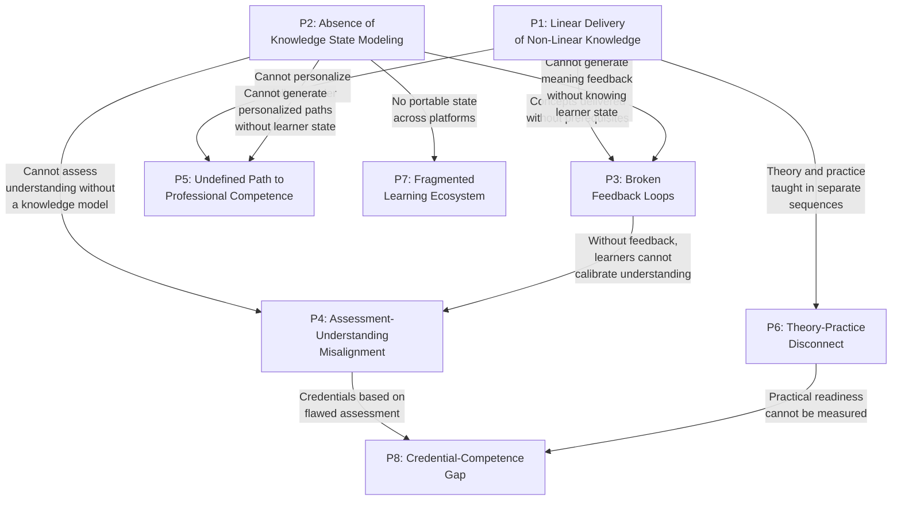

# Problem Statement

**Project:** LearnCS
**Document:** Problem Statement
**Phase:** 0, Project Discovery
**Status:** Draft: Pending Founder Approval

---

## Purpose

This document identifies and analyzes the fundamental problems in Computer Science education that justify the creation of a new product. It does not propose solutions. It does not describe product features. It exists solely to establish, with rigor, that a set of structural failures in CS education remain unsolved, and to explain why.

Every claim in this document is grounded in observable patterns, systemic analysis, and first-principles reasoning.

---

## Problem 1: Linear Delivery of Non-Linear Knowledge

### Description

Computer Science is a domain with dense prerequisite relationships. Concepts do not exist in isolation, they form an interconnected graph where understanding one topic often requires understanding several others, and where topics reinforce each other across branches. Despite this, virtually all CS education, university curricula, textbooks, online courses, and tutorials, delivers knowledge as a linear sequence.

### Evidence / Observation

- University curricula are organized as sequential course lists with minimal cross-referencing. A student takes Data Structures in semester three and Operating Systems in semester five, even though both share foundational dependencies on memory models and computational thinking.
- Online courses present topics as ordered modules. A student encounters recursion in Module 7 without verifying that they have internalized the call stack, scope, or base case reasoning.
- Textbooks are written as numbered chapters. Skipping ahead or reading out of order is structurally discouraged, even when the learner's gaps don't follow the chapter order.
- Learners routinely encounter concepts they lack the prerequisites for. They experience confusion not because the material is inherently difficult, but because a prerequisite they assumed they understood is actually weak.

### Root Cause

Linear delivery persists because it is structurally simple to produce, distribute, and consume. Creating a course as a sequence of lessons requires the author to make one decision: order. Creating a navigable knowledge graph requires the author to model relationships, prerequisite chains, multiple valid learning paths, and conditional dependencies, work that is orders of magnitude more complex and has no established tooling.

Additionally, educational institutions operate on semester-based schedules, which impose linear time constraints on inherently non-linear knowledge. The delivery format is optimized for institutional logistics, not for how knowledge is actually structured.

### Existing Solutions

- **University curricula** define prerequisite courses (e.g., "CS201 requires CS101"). This captures coarse-grained dependencies between entire courses but not between individual concepts within or across courses.
- **Online platforms** (Coursera, Udemy, edX) occasionally suggest "recommended background" but do not enforce or verify prerequisites. Course ordering is left to the learner.
- **Interactive platforms** (Codecademy, freeCodeCamp) sequence exercises in a fixed order that is curated but not adaptive. Every learner walks the same path regardless of prior knowledge.

### Why Existing Solutions Fail

Course-level prerequisites are too coarse to be useful. A student may have passed CS101 but have a weak grasp of pointers or recursion, specific concept-level gaps that a course-level prerequisite system cannot detect. Online platforms avoid enforcing prerequisites because doing so would increase friction and reduce enrollment, which conflicts with their engagement-driven business models.

No existing platform externalizes the actual concept graph of Computer Science into a structure the learner can see, navigate, or benefit from. The graph exists implicitly in the minds of experienced educators but is never made available as a system.

### Impact

Learners build knowledge on unstable foundations. Gaps accumulate silently. Students who feel confused blame themselves or the difficulty of the material, when the actual cause is a missing prerequisite that no system identified. This produces frustration, loss of confidence, and unnecessary attrition.

### Severity

**Critical**

This problem affects every learner in every learning environment. It is not a content quality issue or a UI issue, it is a structural mismatch between how knowledge is organized and how it is delivered. It cannot be solved by producing better courses within the existing linear format.

### If Unsolved

Learners will continue to encounter concepts they are not prepared for. They will continue to confuse prerequisite gaps with personal inadequacy. Attrition rates in CS education will remain high not because the subject is too hard, but because the delivery structure is fundamentally misaligned with the knowledge structure.

---

## Problem 2: Absence of Knowledge State Modeling

### Description

No widely available system maintains an accurate, persistent model of what a CS learner actually understands. Existing platforms track activity, what was watched, clicked, submitted, or completed, but not knowledge. There is no representation of the learner's actual cognitive state: which concepts they have internalized, which they have encountered but not understood, and which they have never been exposed to.

### Evidence / Observation

- A learner completes a 40-hour course on Coursera. The system records 100% completion and a quiz score. The learner moves to another platform. That platform has no information about the learner. The learner effectively starts from zero.
- Within a single platform, "progress" means content consumption. A 75% completion rate tells you how many modules were accessed, not how many concepts were understood.
- Learners frequently report being unable to assess their own competence. "I finished the course but I don't know if I actually learned anything" is one of the most common sentiments in CS learning communities.
- Job interviewers conduct lengthy technical assessments because no existing credential or platform output reliably communicates what the candidate actually knows.

### Root Cause

Modeling actual understanding is a fundamentally different problem from tracking activity. Activity tracking requires logging events (watched video, submitted answer). Knowledge modeling requires continuous assessment, validated cognitive models, and a structured representation of the knowledge domain itself, specifically, Problem 1's missing concept graph.

No platform has invested in building this because their business model does not require it. Course platforms monetize enrollment and completion, not verified understanding. Their incentive is to move learners through content, not to accurately assess whether learning occurred.

### Existing Solutions

- **Learning Management Systems** (Canvas, Moodle, Blackboard) track grades and assignment submissions. They record institutional outputs, not learner knowledge.
- **Adaptive platforms** (Khan Academy, Duolingo) maintain limited internal models of learner state within their own domains. These models are proprietary, non-portable, and scoped to the platform's content rather than to the full domain of CS.
- **Skill assessment platforms** (HackerRank, Pluralsight Skills) provide point-in-time snapshots through standardized tests. These are evaluative snapshots, not continuous models that evolve with the learner.

### Why Existing Solutions Fail

LMS platforms are designed to serve institutions, not learners. Their data model is course-centric (enrollment, grades, deadlines), not knowledge-centric (concepts understood, gaps identified, mastery levels).

Adaptive platforms like Khan Academy come closest but operate within walled gardens. A learner's state in Khan Academy is not portable, not comprehensive across all CS topics, and not designed to interoperate with other learning contexts. The models are also proprietary, the learner themselves cannot inspect or understand their own knowledge map.

Assessment platforms capture a snapshot, not a trajectory. They tell you how you performed on a test at one moment but do not track how your understanding evolves over time, where your gaps are growing, or which previously understood concepts may have decayed.

### Impact

Without a knowledge model, every downstream capability is compromised. Personalization is impossible because the system does not know what the learner knows. Feedback is shallow because there is no understanding to reference. Path generation is generic because there is no state to individualize from. Assessment is disconnected because there is no baseline to measure against.

### Severity

**Critical**

This is a foundational problem. The absence of knowledge modeling is not one failure among many, it is the failure that prevents most other problems from being solved. Personalized learning, meaningful feedback, accurate assessment, and gap identification all depend on having a model of the learner's knowledge state. Without it, these capabilities are structurally impossible.

### If Unsolved

Learning will remain a consumption activity rather than a managed process. Learners will continue to have no reliable self-awareness of their own competence. The gap between "I completed a course" and "I understand this material" will remain invisible and unmeasured.

---

## Problem 3: Broken Feedback Loops

### Description

Effective learning requires tight feedback loops: the learner attempts something, receives meaningful information about the quality of their understanding, and adjusts. In CS education, feedback loops are either absent, severely delayed, or too shallow to drive learning.

### Evidence / Observation

- **Lectures and videos:** Zero feedback. The learner consumes passively. There is no mechanism to detect misunderstanding during consumption.
- **Homework and assignments:** Feedback is delayed by days or weeks. By the time the learner receives it, they have moved on to new topics built on potentially flawed understanding.
- **Online quizzes:** Feedback is binary, correct or incorrect. The learner is told their answer was wrong but not why their reasoning was wrong, which concept was misunderstood, or what prerequisite gap led to the error.
- **Project-based learning:** Feedback comes from the final output (does the project work?) but not from the process (was the approach sound? were the right concepts applied? were there better alternatives?).
- **Self-study:** No external feedback at all. The learner has no way to validate their understanding except by attempting increasingly difficult tasks and observing failure.

### Root Cause

Meaningful feedback requires two things that existing systems lack:

First, a model of what the learner was supposed to understand (the target knowledge state). Without this, feedback can only address the surface level, the answer, not the underlying understanding.

Second, a model of what the learner actually understands (the current knowledge state, Problem 2). Without this, the system cannot diagnose the specific gap that produced the error.

When both models are absent, feedback degrades to the only thing the system can measure: correctness of output. "Your answer is wrong" is the only feedback a system without knowledge models can give.

The delay problem is institutional. Universities batch feedback through grading cycles because individual real-time feedback does not scale with human instructors. Online platforms avoid deep feedback because producing it requires the knowledge infrastructure they haven't built.

### Existing Solutions

- **Auto-graded coding exercises** (LeetCode, HackerRank) provide immediate correctness feedback: your code passed or failed test cases. Some provide hints.
- **Khan Academy** provides exercise-level feedback with hints and suggested review content.
- **AI tutoring tools** (ChatGPT, various EdTech chatbots) provide conversational feedback but without structured understanding of the learner's knowledge state or the domain's prerequisite structure.

### Why Existing Solutions Fail

Auto-graded exercises provide correctness feedback, not understanding feedback. Passing test cases proves the code works, it does not prove the learner understands why it works, could reproduce the approach, or could apply the underlying concept to a different problem.

Khan Academy's model works well for mathematics, where concepts are relatively discrete and sequential. CS knowledge is denser and more interconnected, making simple hint-based feedback insufficient for diagnosing multi-concept gaps.

AI tutoring tools provide responsive conversation but lack structured domain knowledge. They can explain a concept when asked but cannot proactively identify that a learner's error on Topic X stems from a gap in Topic Y, because they do not maintain a persistent model of either the domain or the learner.

### Impact

Without meaningful feedback, learners cannot distinguish between consumption and comprehension. This produces "tutorial hell", the cycle of consuming content, feeling temporarily confident, attempting application, failing, and consuming more content. The learner is not lazy or incapable; they are operating without the feedback signal required to learn effectively.

### Severity

**Critical**

Feedback is the mechanism through which learning occurs. Without it, content consumption produces the illusion of learning without the substance. This affects every learner regardless of platform, motivation level, or talent.

### If Unsolved

Learners will continue to conflate watching with understanding. Self-directed learners will remain trapped in cycles of consumption without measurable progress. Motivation will erode as effort fails to produce visible competence gains.

---

## Problem 4: Assessment-Understanding Misalignment

### Description

The dominant assessment methods in CS education, timed exams, multiple-choice quizzes, and auto-graded coding challenges, measure outputs that correlate weakly with actual understanding. They test whether a learner can reproduce a known solution under constraints, not whether they understand the underlying concepts well enough to apply them to unfamiliar situations.

### Evidence / Observation

- University students pass algorithm exams by memorizing implementations and pattern-matching problem types. When presented with a variation they have not seen, performance drops sharply, indicating memorization, not understanding.
- Online quiz scores reflect recognition ability (choosing the correct answer from options) rather than generation ability (producing the answer independently).
- Coding challenge platforms (LeetCode) have produced a subculture of "grinding", solving hundreds of problems through pattern memorization. Employers have observed that high LeetCode performance does not reliably predict on-the-job engineering competence.
- Students frequently pass courses and later discover they cannot apply the material. The assessment told them they succeeded; reality tells them otherwise.

### Root Cause

Valid assessment of understanding, the ability to apply concepts to novel problems, reason about trade-offs, decompose unfamiliar systems, and debug unexpected behavior, is inherently difficult to design, difficult to administer at scale, and difficult to grade automatically.

Education systems optimize assessment for scalability. Multiple-choice tests can be graded instantly. Timed exams fit institutional schedules. Auto-graded coding problems can serve millions of users. In every case, the assessment format is chosen for operational efficiency, not for validity as a measurement of understanding.

Furthermore, assessing true understanding requires knowing the knowledge structure (which concepts are prerequisites, which are related, which are independent). Without this structure, assessment can only test isolated facts or procedures, not integrated understanding.

### Existing Solutions

- **Universities** use exams, projects, and oral defenses. Projects come closest to assessing real understanding, but grading them is resource-intensive and subjective.
- **Coding platforms** use test-case-based auto-grading. This assesses whether code produces correct output, not whether the learner's mental model is correct.
- **Certification programs** (AWS, Azure, CompTIA) use standardized tests. These assess breadth of knowledge at a recognition level but not depth of understanding.
- **Technical interviews** use whiteboard problems and system design questions. These are the closest approximation to understanding assessment but are unstandardized, biased, and occur only at the point of hiring, not during learning.

### Why Existing Solutions Fail

Every existing assessment method is optimized for a constraint other than validity:

- University exams are optimized for scheduling and grading efficiency.
- Auto-graded problems are optimized for automation.
- Certifications are optimized for standardization.
- Technical interviews are optimized for a hiring decision, not for learning.

None are optimized for the question that matters: "Does this person actually understand this concept well enough to use it in a context they haven't encountered before?"

Additionally, all existing assessments are point-in-time measurements. They capture performance at one moment but do not track understanding over time. A student who scored 90% on a data structures exam six months ago may retain significantly less today. No system accounts for knowledge decay.

### Impact

Learners receive inflated signals of competence. They believe they understand material that they have only memorized. This produces false confidence that collapses when real application is required, during job interviews, on-the-job tasks, or advanced coursework that builds on supposedly understood material.

Employers have lost trust in educational outputs entirely. The existence of the technical interview, a costly, time-consuming, often flawed process, is direct evidence that the market does not believe existing assessment can be trusted.

### Severity

**High**

While critical in its downstream effects, this problem is partially downstream of Problem 2 (absence of knowledge modeling). If knowledge state were modeled accurately, assessment could be designed to probe gaps specifically. The assessment problem is severe but not fully independent, it is amplified by the lack of foundational knowledge infrastructure.

### If Unsolved

The disconnect between credentials and competence will persist. Employers will continue to rely on costly, inconsistent interview processes. Learners will continue to overestimate their readiness and underperform when real application is required.

---

## Problem 5: Undefined Path to Professional Competence

### Description

A person who decides to learn Computer Science with the goal of becoming a working professional faces a landscape with no reliable, personalized path from their current state to career readiness. There are thousands of courses, conflicting recommendations, no way to assess where they stand, and no way to know when they have learned enough.

### Evidence / Observation

- "What should I learn first?" and "What order should I learn things in?" are among the most frequently asked questions in CS learning communities (Reddit, Stack Overflow, Discord).
- The advice learners receive is contradictory: "Start with Python." "No, start with C." "Learn JavaScript first." "Fundamentals don't matter, just build projects." "Don't skip fundamentals." Each recommendation reflects the advisor's personal path, not an objective analysis.
- "Roadmap" websites (roadmap.sh, etc.) provide generic visual maps of technologies but do not account for the learner's current knowledge, goals, or pace. Every learner sees the same roadmap.
- Career switchers, adults moving into tech from other fields, are particularly affected. They have limited time, high stakes, and no reliable guide.
- "Imposter syndrome" in CS is extensively documented. A significant contributor is the absence of any external signal that tells a learner: "You know enough. You are ready."

### Root Cause

The path from "interested in CS" to "professionally competent" has never been formally modeled. The mapping between CS knowledge and professional requirements exists as tacit knowledge distributed among experienced practitioners, hiring managers, and educators, but it has never been externalized into a navigable system.

This is because the mapping is genuinely complex. Professional competence in software engineering is not a single linear path, it varies by role (frontend, backend, data, security, infrastructure), by industry, by company size, and by seniority level. Modeling all of these paths requires both deep domain expertise and a structured representation of the CS knowledge domain, which circles back to Problem 1 (no externalized knowledge structure).

Additionally, the entities that could produce this mapping have no incentive to do so. Universities measure success by graduation and research output. Bootcamps measure success by job placement rates within a narrow scope. Online platforms measure success by engagement and completion. None are incentivized to solve the path problem comprehensively.

### Existing Solutions

- **University degree programs** provide a four-year structured path but are rigid, expensive, not personalized, and not accessible to self-learners or career switchers.
- **Bootcamps** provide an accelerated path but scope it narrowly (typically full-stack web development) and sacrifice depth for speed.
- **Roadmap websites** provide visual technology maps but without personalization, prerequisite enforcement, or progress tracking.
- **Mentorship** provides personalized guidance but is scarce, expensive, and inconsistent in quality.

### Why Existing Solutions Fail

Degree programs solve the path problem through rigidity, every student follows the same path regardless of background, goals, or pace. This works for a subset of learners (18-year-olds with four years and significant funding) but excludes the majority of people who want to learn CS.

Bootcamps solve the path problem through scope reduction, narrowing the definition of "professional readiness" to "can build a web application in 12 weeks." This produces junior developers who can execute but often lack the foundational understanding to grow.

Roadmap websites provide structure without intelligence. They show what exists but cannot tell an individual learner: "Given what you already know, here is your specific next step."

None of these solutions are both personalized and comprehensive.

### Impact

Learners waste significant time and money on content that does not move them toward their goals. They experience analysis paralysis (unable to choose from thousands of options), tutorial hell (jumping between resources without depth), or imposter syndrome (unable to gauge their own readiness). Many capable individuals abandon CS learning entirely, not because they lack ability, but because they lack a navigable path.

### Severity

**High**

This problem is universal across self-directed learners and acute for career switchers. It is partially downstream of Problems 1 and 2 (without a knowledge graph and a knowledge model, personalized paths cannot be generated), but it also exists independently as a failure of the educational ecosystem to provide guidance.

### If Unsolved

CS education will continue to produce two populations: those who happen to find a path that works (through luck, privilege, or strong mentorship) and those who don't. The latter group, likely the majority, will either abandon CS or arrive at the job market with fragmented, unreliable preparation.

---

## Problem 6: Theory-Practice Disconnect

### Description

Academic Computer Science and practical software engineering are taught and learned as though they are separate disciplines. Theory is encountered in classrooms and textbooks. Practice is encountered in bootcamps, side projects, and jobs. The bridge between them, understanding when and why to apply a theoretical concept to a practical problem, is left almost entirely to the learner to figure out independently.

### Evidence / Observation

- CS graduates frequently report that their degree did not prepare them for the practical demands of software engineering. They understand algorithmic complexity in theory but struggle with real-world debugging, version control, code review, and system design.
- Bootcamp graduates can build functional applications but often lack understanding of why their code works, how to optimize it, or how to reason about it at a systems level.
- Job postings routinely require both theoretical knowledge (algorithms, data structures) and practical skills (frameworks, tools, deployment). No single learning environment covers both with equal depth.
- The first 6-12 months of a junior developer's career is effectively spent bridging this gap on the job, a costly process for both the individual and the employer.

### Root Cause

Theory and practice are taught by different institutions with different incentive structures:

- **Universities** are incentivized to produce researchers and to maintain academic rigor. Practical engineering skills (version control, CI/CD, code review) are considered vocational and beneath the academic mission. Faculty are hired for research output, not industry experience.
- **Bootcamps** are incentivized to place graduates in jobs quickly. Theoretical depth is sacrificed because it doesn't directly produce job-ready outputs within compressed timelines.
- **Online platforms** tend to bifurcate into theoretical courses (often ported from universities) and practical tutorials (learn React, build a to-do app). Integrated learning that connects theory to application is rare because it requires instructional design expertise that spans both domains.

The root cause is not that theory and practice are inherently separate, they are deeply connected. The root cause is that no learning environment has an incentive or a structure to teach them as connected.

### Existing Solutions

- **University capstone projects** and **internships** attempt to bridge the gap by placing students in practical contexts. These occur at the end of the degree, not throughout.
- **Project-based courses** (on Udemy, YouTube, etc.) teach practical skills but often without underlying theoretical grounding, the learner follows steps without understanding the principles.
- **Open-source contribution** provides real-world practice but requires a baseline of practical skill that beginners don't have, and provides no structured learning.

### Why Existing Solutions Fail

Capstone projects and internships are too little, too late. They arrive at the end of a multi-year program, after years of purely theoretical study. By that point, students have already internalized the separation between theory and practice.

Project-based tutorials teach procedures, not understanding. "Build a REST API with Node.js" teaches the learner to follow a recipe. It does not teach them why REST is designed the way it is, when it's the wrong choice, or how it relates to distributed systems theory.

None of these solutions systematically connect theoretical concepts to practical applications throughout the learning journey. The connection is always incidental, not structural.

### Impact

The job market receives two types of inadequately prepared candidates: those with theory but no practice, and those with practice but no theory. Both require significant on-the-job training. Employers absorb this cost through extended onboarding, senior developer mentorship time, and reduced productivity of junior hires.

Learners experience the gap as a crisis of confidence. The CS graduate who cannot set up a development environment feels their education was a waste. The bootcamp graduate who cannot pass a technical interview feels they are fundamentally lacking. Both are partially right, but the failure is structural, not personal.

### Severity

**High**

This problem is universal across CS education models. It is not specific to any country, institution, or platform. It produces measurable economic waste (extended onboarding costs) and measurable human cost (frustration, imposter syndrome, career delays).

### If Unsolved

The CS education ecosystem will continue to produce graduates who are half-prepared. Employers will continue to absorb the training cost that educational institutions externalize. The first year of every software engineering career will continue to be remedial, filling gaps that should have been addressed during learning.

---

## Problem 7: Fragmented and Non-Interoperable Learning Ecosystem

### Description

A typical CS learner uses multiple platforms: YouTube for explanations, Codecademy or freeCodeCamp for practice, LeetCode for interview prep, Stack Overflow for troubleshooting, university courses for structure, and various tutorials for specific technologies. None of these platforms share data, progress, context, or knowledge state. Each exists as a closed system. The learner is the only integration point, and they have no tools to perform that integration.

### Evidence / Observation

- A learner watches a 10-hour algorithms course on YouTube. They then sign up for a data structures course on Coursera. Coursera has no knowledge of what the learner already studied. Content overlaps. Time is wasted.
- Progress in one platform is invisible to another. A learner's Khan Academy mathematics progress has no bearing on their Codecademy Python course, even when the concepts are directly related.
- Learners maintain personal notes, bookmarks, and spreadsheets to track their own progress across platforms, a manual process that is error-prone and unsustainable.
- Switching platforms means starting over. This creates lock-in through inertia (sunk cost of progress), not through genuine value.

### Root Cause

Each platform is built as a self-contained product with its own content model, progress tracking, and user data. There is no shared standard for representing CS knowledge, learner state, or learning progress. Interoperability standards that do exist (xAPI, LTI, SCORM) are designed for institutional LMS integration, not for learner-centric knowledge portability.

Furthermore, platform business models discourage interoperability. User data is an asset. Engagement metrics drive revenue. A platform that exports learner state to competitors reduces its own stickiness. The incentive structure actively works against interoperability.

### Existing Solutions

- **LTI (Learning Tools Interoperability)** allows institutional tools to share grade data. It serves institutions, not learners, and does not support knowledge-level interoperability.
- **LinkedIn Learning** and similar platforms attempt to be comprehensive single platforms, reducing the need for cross-platform integration. However, no single platform covers the full breadth and depth of CS education.
- **Personal knowledge management tools** (Notion, Obsidian) allow learners to manually organize their learning. These require significant effort and discipline, and do not integrate with learning platforms programmatically.

### Why Existing Solutions Fail

Technical standards like LTI solve institution-to-institution data exchange, not learner-to-learner knowledge continuity. They transmit grades, not understanding.

Comprehensive platforms attempt to eliminate fragmentation by being the only platform the learner needs. This is unrealistic for CS education, which spans theoretical foundations, practical skills, tools, frameworks, system design, and professional development, a scope no single platform has achieved.

Manual tracking places the integration burden on the learner, who is the least equipped to perform it. A learner cannot accurately assess their own knowledge state (Problem 2), so asking them to manually track it across platforms is asking them to do something that even purpose-built systems fail to do.

### Impact

Learners waste time repeating content they have already encountered on other platforms. They have no unified view of their knowledge or progress. The fragmented experience increases cognitive load, reduces motivation, and makes long-term learning plans nearly impossible to execute.

### Severity

**Medium**

While frustrating and wasteful, this problem is less severe than the foundational issues of knowledge modeling and feedback. Many learners work around it through persistence and manual organization. However, it significantly increases the friction of sustained, long-term learning and disproportionately affects learners with less time and fewer resources.

### If Unsolved

Learning will remain a fragmented experience where each platform restart erodes motivation and wastes time. Long-term, self-directed learning journeys, the type that CS mastery requires, will remain unnecessarily difficult to sustain.

---

## Problem 8: Credential-Competence Gap

### Description

The credentials currently available in CS education, university degrees, bootcamp certificates, online course certificates, and professional certifications, do not reliably communicate what the holder actually knows or can do. Employers, learners, and institutions all know this, but no alternative has emerged.

### Evidence / Observation

- The technical interview exists specifically because employers do not trust credentials. If a degree or certificate reliably indicated competence, multi-round technical interviews would be unnecessary.
- Certificate mills (platforms that issue certificates for course completion regardless of learning quality) have devalued online credentials to the point where many hiring managers ignore them entirely.
- A university degree indicates that a person spent four years in an academic program and passed exams, it says little about their current skill level, practical abilities, or specific knowledge gaps.
- Learners accumulate certificates as signals of effort but recognize that these certificates carry diminishing weight. "I have 15 Udemy certificates" does not translate to credibility.

### Root Cause

Credentials are issued based on proxies, completion, exam scores, attendance, rather than on validated understanding. This is a direct consequence of Problem 4 (assessment-understanding misalignment): if assessment doesn't measure real understanding, credentials based on assessment can't represent real understanding.

Additionally, credentials are static. A degree earned five years ago reflects (at best) the holder's knowledge at the time of graduation. It does not account for knowledge decay, new technologies learned since then, or skills atrophied from disuse. Competence is dynamic; credentials are frozen.

The entities that issue credentials lack the means to make them accurate. Universities don't have persistent knowledge models. Online platforms don't have validated assessments. The credential is only as good as the measurement behind it, and the measurement is structurally flawed.

### Existing Solutions

- **University degrees** remain the most widely recognized credential but are expensive, time-consuming, and increasingly questioned by employers.
- **Professional certifications** (AWS, Google, Microsoft) are domain-specific and assessment-backed but test recognition and recall, not deep understanding. They also expire, which partially addresses the decay problem.
- **Portfolio projects** (GitHub profiles, personal websites) allow learners to demonstrate practical skill directly. These are valued by some employers but are difficult to evaluate consistently and can be misleading (tutorial-following vs. genuine understanding).
- **Micro-credentials and badges** attempt to provide granular skill signals but lack standardization and trust.

### Why Existing Solutions Fail

Every credential system fails for the same fundamental reason: it is disconnected from an accurate, continuous model of the learner's knowledge. Degrees, certificates, and badges are issued at a point in time, based on an assessment of limited validity, and never updated. They are snapshots of a proxy, not a live signal of competence.

Portfolio projects come closest to representing real ability but require the evaluator to invest significant time in review, making them impractical for initial screening in high-volume hiring.

No existing credential is both accurate (reflecting real, current understanding), granular (indicating specific competencies, not just broad domains), and trustworthy (backed by validated assessment methodology).

### Impact

The credential-competence gap creates waste on all sides. Employers spend enormous resources on technical interviews to measure what credentials should communicate. Learners invest time and money in credentials that do not open doors. Educational institutions issue credentials they know are imperfect but have no mechanism to improve.

The learners most harmed are those without access to strong professional networks, they rely on credentials to communicate competence, and those credentials fail them.

### Severity

**High**

While partially downstream of other problems (specifically Problems 2 and 4), the credential gap has independent, severe consequences. It shapes hiring practices, learner investment decisions, and institutional incentive structures across the entire CS education ecosystem.

### If Unsolved

Employers will continue to distrust educational outputs. The cost of hiring will remain artificially high. Self-taught and non-traditional learners will continue to face barriers not because they lack competence, but because they lack a trusted way to prove it.

---

## Relationships Between Problems

The eight problems identified above are not independent. They form a causal system where foundational failures produce downstream consequences.

### Interpretation

**Root causes** (problems that produce other problems):
- **Problem 1** (Linear Delivery) and **Problem 2** (No Knowledge Modeling) are the two foundational failures. Together, they produce or amplify five of the remaining six problems.

**Intermediate problems** (both caused by and causing other problems):
- **Problem 3** (Broken Feedback) is caused by P1 and P2, and contributes to P4.
- **Problem 4** (Assessment Misalignment) is caused by P2 and P3, and directly produces P8.

**Downstream consequences** (largely produced by upstream failures):
- **Problem 5** (Undefined Path), **Problem 6** (Theory-Practice Gap), **Problem 7** (Fragmented Ecosystem), and **Problem 8** (Credential Gap) are real and severe, but they are substantially downstream of the foundational failures.

---

## Problem Prioritization

| Problem | Severity | Frequency | Business Impact | Learning Impact | Priority |
|---------|----------|-----------|-----------------|-----------------|----------|
| P1: Linear Delivery of Non-Linear Knowledge | Critical | Universal | High | Critical | **P0** |
| P2: Absence of Knowledge State Modeling | Critical | Universal | High | Critical | **P0** |
| P3: Broken Feedback Loops | Critical | Universal | Medium | Critical | **P0** |
| P4: Assessment-Understanding Misalignment | High | Universal | High | High | **P1** |
| P5: Undefined Path to Professional Competence | High | High | High | High | **P1** |
| P6: Theory-Practice Disconnect | High | High | High | High | **P1** |
| P7: Fragmented Learning Ecosystem | Medium | High | Medium | Medium | **P2** |
| P8: Credential-Competence Gap | High | High | High | Medium | **P1** |

### Prioritization Rationale

**P0**: Problems 1, 2, and 3 are foundational. They are root causes that produce or amplify the remaining problems. Any product that addresses CS education without solving these three will be treating symptoms.

**P1**: Problems 4, 5, 6, and 8 are high-severity and high-frequency but are partially downstream of the P0 problems. Solving the P0 problems creates the structural foundation needed to address these effectively.

**P2**: Problem 7 (fragmentation) is real and frustrating but is lower severity and can be partially addressed as a consequence of solving the knowledge modeling problem (P2). It does not require independent, first-priority attention.

---

*End of Document*
